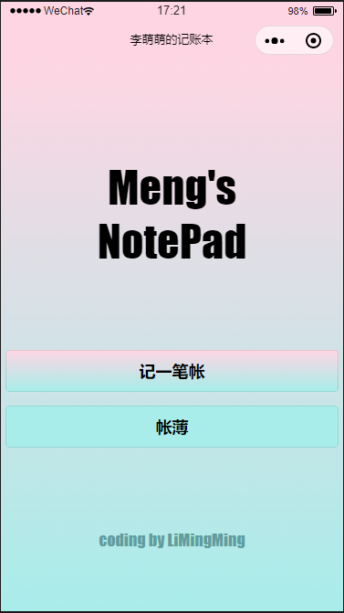
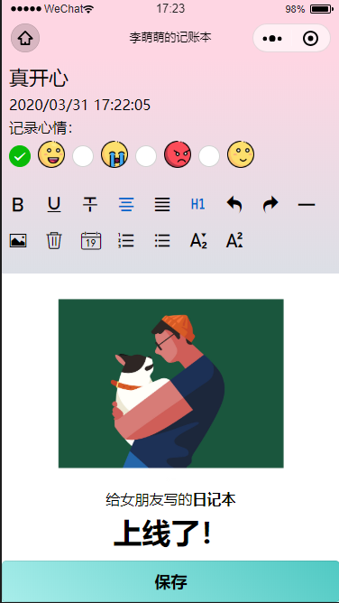
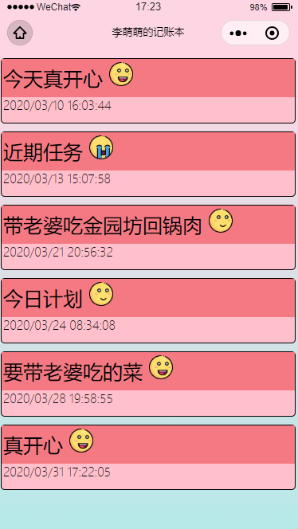
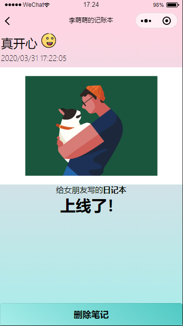

# MengsNote

[中文](./README.zh-CN.md) | English

### Description
A diary WeChat Mini Program developed for my girlfriend. Currently, it implements basic CRUD (Create, Read, Update, Delete) functionality.

## Demo

### Home Page

### Write Note

### Note List

### Note Detail

### QR Code to Experience

> Please just take a quick look, my free cloud environment can't handle too much traffic.